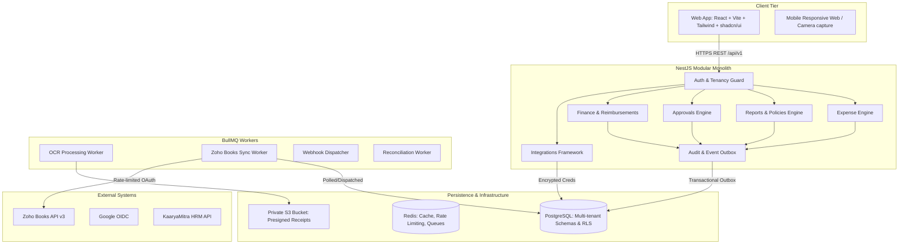
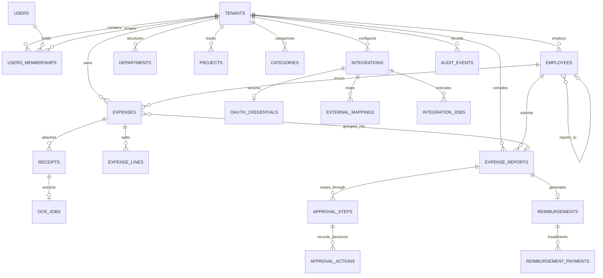
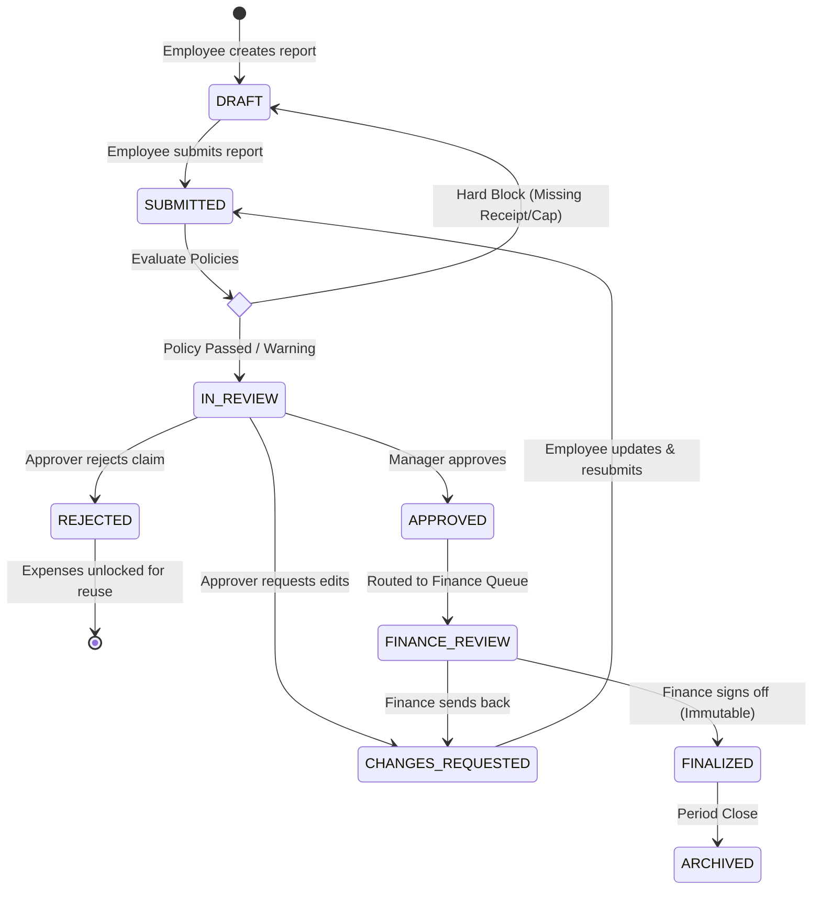
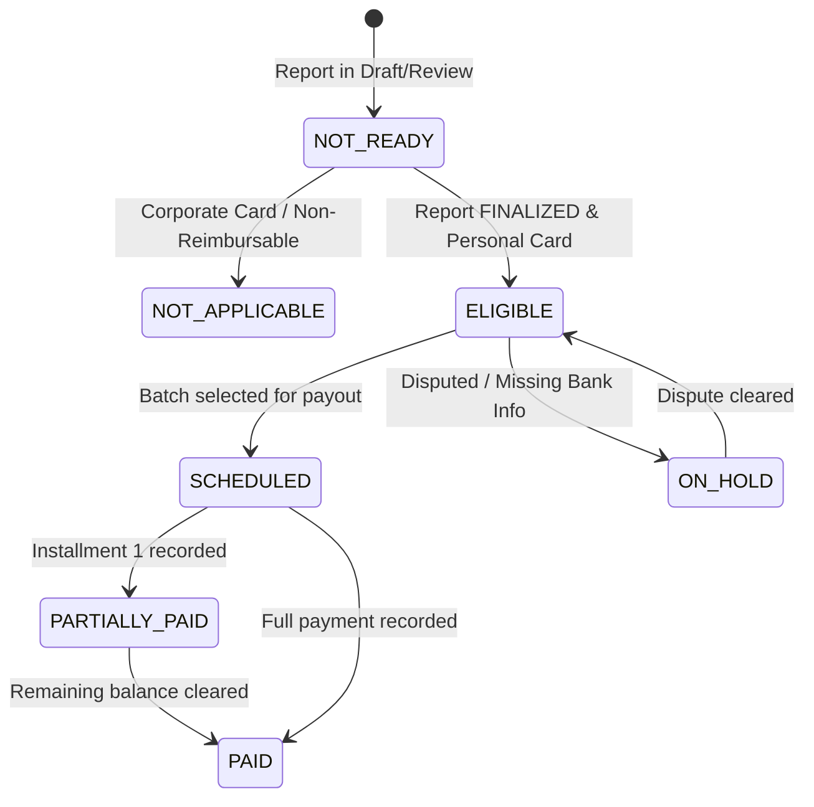
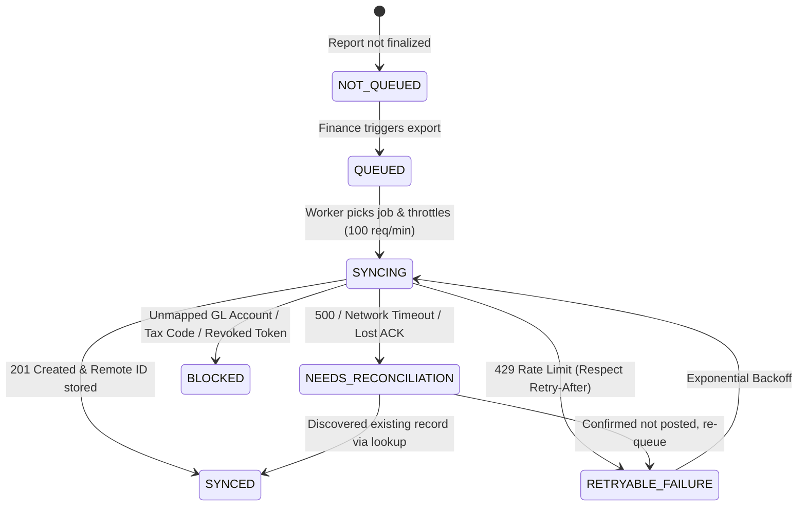

# VyayMitra — Architecture Specification & Diagrams

## 1. System Architecture
VyayMitra is architected as a modular monolith with strict domain boundaries, transactional outbox eventing, and worker isolation.



---

## 2. Entity Relationship Diagram (ERD)



---

## 3. Expense Report Lifecycle State Machine



---

## 4. Reimbursement Payment State Machine
*(Strictly decoupled from Approval status)*



---

## 5. Accounting Sync & Reconciliation State Machine
*(Zoho Books Transactional Outbox Pattern)*



---

## 6. M7 Runtime and Observability Boundaries

```mermaid
flowchart LR
    Client -->|request + optional X-Request-ID| RequestContext
    RequestContext --> RateLimit
    RateLimit --> Validation
    Validation --> Domain[Existing /api/v1 domain routes]
    Domain --> ResponseTelemetry
    ResponseTelemetry --> Metrics[Bounded in-process metrics]
    ResponseTelemetry --> StructuredLog[Structured log without body/token/PII]
    Operator -->|Bearer OBSERVABILITY_TOKEN| MetricsEndpoint[/internal/metrics]
    Probe --> Liveness[/api/health/live]
    Probe --> Readiness[/api/health/ready]
    Readiness --> PostgreSQL[(PostgreSQL SELECT 1)]
```

Operational endpoints follow these boundaries:

- Liveness never depends on external providers and answers whether the process event loop is serving requests.
- Readiness returns `503` when PostgreSQL is unavailable in production. Development may report a degraded offline state so the existing local mock workflow remains runnable.
- Metrics labels are restricted to HTTP method, normalized route template, and status class. Tenant IDs, user IDs, URLs with UUIDs, request bodies, tokens, and receipt data are excluded.
- The metrics endpoint is disabled unless `OBSERVABILITY_TOKEN` is configured and uses constant-time token comparison.
- Request IDs are validated before reflection, generated cryptographically when absent, returned in `X-Request-ID`, and shared by errors, logs, and response envelopes.

## 7. Retention and Recovery Boundary

Retention policy is environment-configured and tenant-scoped. The API defaults to preview-only operation. It may identify expired OCR provider payloads, webhook delivery payloads, and dispatched outbox payloads, but it must not delete audit events, approvals, reimbursements, reimbursement payments, finalized reports, integration mappings, or external references.

Database recovery is an operator workflow rather than an HTTP endpoint:

```text
pg_dump (custom format) -> SHA-256 manifest -> separate restore database
    -> pg_restore --clean --if-exists -> schema/tenant/audit verification
    -> signed drill record -> production restore approval
```

Production restore scripts reject a target database matching the source URL and require an explicit confirmation flag.
